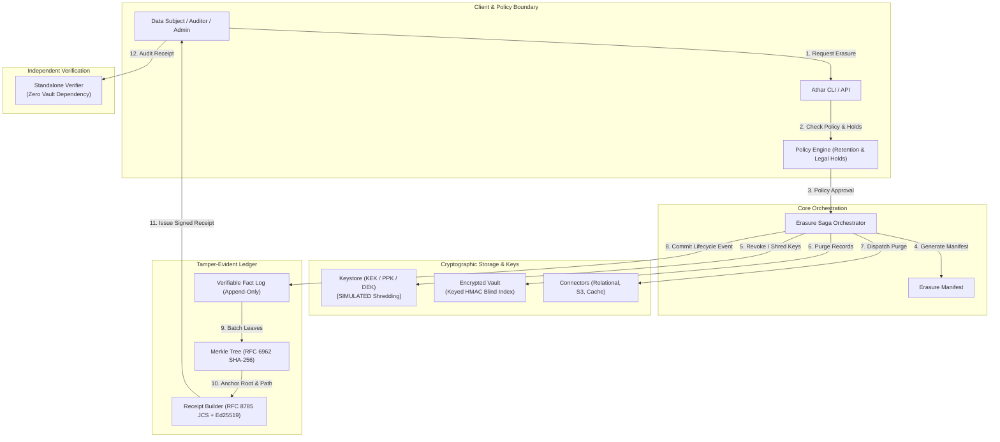

# Athar – Verifiable Erasure Receipts

*A research project of **Khafi Labs** (My Personal Laboratories). Alpha research prototype, Apache-2.0.*

Repository: https://github.com/Khafi-Labs/athar

[](https://github.com/Khafi-Labs/athar/actions/workflows/ci.yml) [](https://github.com/Khafi-Labs/athar/actions/workflows/security.yml) [](https://github.com/Khafi-Labs/athar/actions/workflows/codeql.yml)

**Athar** is a reference implementation for generating, anchoring, and independently verifying cryptographic receipts for data erasure workflows under privacy regulations. The current policy model follows GDPR (Article 17) concepts; Egyptian law (PDPL 151/2020, CBE rules) is not yet modelled.

---

## Project Status and Scope

Athar is an **alpha research prototype**, not a compliance product.

- **Working:** the cryptographic core (RFC 8785 canonical JSON, RFC 6962 Merkle log, Ed25519), the in-memory keystore/vault, the policy engine, the erasure saga, the receipt builder, the standalone verifier, and the end-to-end demo (`athar demo` / `python -m demo.quickfin`).
- **Not implemented:** the `enroll`, `erase`, `receipt` and `status` CLI commands exit with an error, because the keystore and vault are in-memory only and there is no persistent state for a CLI to act on. There is no persistent keystore, no HSM/KMS integration, and no real RFC 3161 TSA in the shipped configuration (anchors are `SIMULATED`).
- **Jurisdiction:** an Egypt policy pack (`athar.policy.jurisdictions.egypt`) provides regime-specific templates (CBE bank, CBE money-transfer/exchange, FRA non-bank, PDPL controller), AML retention rules with citations, and Arabic/English receipt disclosures. Only the AML retention periods could be sourced; every other period is an **unconfirmed placeholder that blocks erasure** until counsel supplies it. The pack has not been legally reviewed and using it does not make an organisation compliant. See [`docs/egypt_legal_notes.md`](docs/egypt_legal_notes.md). Nothing here is legal advice.

**Documentation:** [overview paper](docs/overview.md) · [limits of the claim](docs/limits_of_the_claim.md) · [threat model](docs/threat_model.md) · [Egypt legal notes](docs/egypt_legal_notes.md) · [positioning guide](docs/positioning.md) · [roadmap](ROADMAP.md) · [security policy](SECURITY.md) · [contributing](CONTRIBUTING.md)

---

## Limits of the Claim

Verifiable erasure receipts establish clear cryptographic evidence within defined system boundaries. To maintain scientific and legal integrity, the exact scope and limitations of what an Athar receipt attests to are stated upfront:

### What an Athar Receipt Attests To
1. **Adherence to Erasure Protocol**: Attests that the erasure saga executed all prescribed lifecycle steps across registered data stores and connectors in compliance with active policy rules.
2. **Cryptographic Key Destruction (Attestation)**: Attests that designated Data Encryption Keys (DEKs) and Pseudonym Protection Keys (PPKs) assigned to the subject's partition were flagged, revoked, or cryptographically shredded within the managed keystore *(Note: in this MVP, all key destruction operations are explicitly labeled and executed as **SIMULATED**)*.
3. **Tamper-Evident Inclusion**: Attests that the erasure transaction was committed to an append-only verifiable fact log, anchored within an RFC 6962 Merkle tree, and timestamped.
4. **Non-Repudiation of Issuance**: Attests via an Ed25519 digital signature that an authorized erasure authority issued the receipt over an RFC 8785 canonical JSON representation.
5. **Auditable Retention & Hold Check**: Attests that active retention periods and legal hold states were evaluated prior to executing the erasure procedure.

### What an Athar Receipt Does NOT Attest To
1. **Absence of Unmanaged Offline Copies**: A receipt cannot verify that unmanaged copies do not exist outside the defined system boundary (e.g., untracked manual exports, illicit exfiltration, air-gapped tape archives, or raw system crash dumps).
2. **Physical Solid-State Zeroization**: A receipt attests to cryptographic key revocation/shredding and connector purge commands, not physical electron-level or magnetic realignment on raw flash storage or platter media.
3. **Third-Party Upstream / External Omission**: Connectors attest to dispatching deletion instructions to registered external endpoints, but receipt verification cannot inspect internal unmanaged operational databases of external third parties beyond their signed connector acknowledgment.

Athar produces verifiable cryptographic attestation and audit evidence; it makes no claims extending beyond the explicitly registered cryptographic perimeter.

---

## Overview

Traditional compliance reporting for data subject erasure requests relies on email notifications, subjective ticketing logs, or blind trust. Regulators, independent auditors, and data subjects lack an automated, tamper-evident mechanism to inspect and validate erasure claims.

Athar solves this by introducing **Verifiable Erasure Receipts**:

- **Cryptographic Key Shredding**: Records are encrypted per subject using distinct Data Encryption Keys (DEKs). Erasure renders ciphertext permanently unrecoverable by destroying the corresponding key material.
- **Append-Only Merkle Fact Log**: Every erasure lifecycle event is recorded in a verifiable fact log structured as an RFC 6962 Merkle tree (SHA-256 with `0x00` leaf and `0x01` internal node prefixes).
- **Canonical Serialization**: Receipt payloads are normalized using RFC 8785 JSON Canonicalization Scheme (JCS) before signing, ensuring deterministic byte representations across heterogeneous platforms.
- **Asymmetric Signature Attestation**: Every receipt is signed using Ed25519 by the issuing authority.
- **Zero-PII Storage**: Subjects are identified strictly via random pseudonyms. Lookups use keyed HMAC blind indexes—plain hashes of personal identifiable information are never stored or logged.
- **Standalone Verifier**: Receipts can be validated by data subjects or external auditors using a standalone verification tool without access to the internal vault or operational databases.

---

## Architecture

The system coordinates key lifecycle operations, encrypted storage partitions, policy evaluations, and append-only ledger anchoring.



### Component Breakdown

| Component | Responsibility |
| :--- | :--- |
| **`athar.crypto`** | Canonical JSON (RFC 8785), Merkle trees (RFC 6962 with SHA-256, prefixes `0x00`/`0x01`), Ed25519 signing/verifying, keyed HMAC blind indexing. |
| **`athar.keystore`** | Hierarchical key management (KEK $\rightarrow$ PPK $\rightarrow$ DEK) and simulated key destruction workflows. |
| **`athar.vault`** | Authenticated record encryption (AES-GCM / ChaCha20-Poly1305), random pseudonym mapping, and blind indexed lookups. |
| **`athar.policy`** | Evaluation of declarative retention rules, jurisdiction constraints, and legal hold overrides. |
| **`athar.erasure`** | Multi-step erasure saga execution, manifest compilation, connector dispatch, and compensation on failure. |
| **`athar.log`** | Append-only verifiable event log and Merkle tree batching. |
| **`athar.receipt`** | Canonical serialization and Ed25519 signing of structured audit receipts. |
| **`verifier`** | Standalone verification package decoupled from vault dependencies. |

---

## Quick Start

### Installation

Requires Python 3.11 or higher.

```bash
# Clone repository
git clone <your-repository-url>
cd Athar

# Install core package in editable mode
pip install -e .

# Optional: install with development tools
pip install -e ".[dev]"
```

### Command-Line Interface

Two commands are functional; the other four (`enroll`, `erase`, `receipt`, `status`) are placeholders that exit with status 2 until a persistent keystore/vault exists. Use the Python API for those workflows.

#### 1. Run the QuickFin demonstration
Runs the real end-to-end pipeline (vault, saga, Merkle log, receipt, verifier) and can export the receipt and the issuer's public key:
```bash
athar demo --scenario quickfin --receipt-out receipt.json --public-key-out issuer.pub
```

#### 2. Verify a receipt
Verification requires the issuer's public key, obtained out-of-band. A receipt can only be verified against the key you pin; the key embedded inside a receipt proves nothing about who issued it.
```bash
athar verify --receipt receipt.json --public-key issuer.pub
```
`--trust-embedded-key` checks self-consistency only (a warning is always printed). Receipts without a timestamp token, or whose Merkle path does not reconstruct the root, fail.

---

## Egypt Policy Pack

```python
from athar.policy import PolicyEngine
from athar.policy.jurisdictions import EgyptRegime, egypt_policy, EGYPT_LIMITS_EN, EGYPT_LIMITS_AR

engine = PolicyEngine(egypt_policy(EgyptRegime.CBE_BANK))  # NOT_REVIEWED by counsel
# Retention clocks run from the rule's retention_trigger (e.g. ACCOUNT_CLOSURE):
# pass that date as data_created_at to ErasureSaga.plan().
# ReceiptBuilder.build(..., extra_limits=EGYPT_LIMITS_EN + EGYPT_LIMITS_AR,
#     jurisdiction={"code": "EG", "regime": "CBE_BANK",
#                   "legal_review": "NOT_REVIEWED", "anchor_location": "UNSPECIFIED"})
```

## Python API Usage

Minimal signing example (a full receipt flow is in `demo/quickfin.py`):

```python
from athar.crypto.canonical_json import canonical_json
from athar.crypto.signing import SigningKeyPair

# 1. Initialize signer
signer = SigningKeyPair.generate(key_id="example")

# 2. Build canonical receipt
payload = {
    "version": "1.0",
    "subject_pseudonym": "subj_a7c38df10e82",
    "action": "erasure",
    "key_destruction": "SIMULATED",
    "timestamp": "2026-10-13T12:00:00Z",
}
canonical_bytes = canonical_json(payload)

# 3. Sign attestation
signature = signer.sign(canonical_bytes)
```

---

## Standalone Verifier

Auditors, regulators, and data subjects do not need access to the Athar vault or operational databases. The standalone verifier operates solely on:
- The receipt document (`receipt.json`)
- The issuer's Ed25519 public key (pinned, obtained out-of-band)
- The Merkle log root anchor

Install only the verifier dependencies:
```bash
pip install -e ".[verifier]"
python -m verifier.verifier receipt.json --public-key issuer.pub
```

The verifier executes:
1. Canonical JSON representation validation according to RFC 8785.
2. Re-calculation of the leaf hash (`0x00 || entry_bytes`).
3. Merkle audit path traversal (`0x01 || left || right`) to match the published root hash.
4. Cryptographic validation of the Ed25519 signature over the canonical payload.

---

## Development

### Setup

```bash
# Install development dependencies
pip install -e ".[dev]"
```

### Running Tests

```bash
# Execute unit and property tests
pytest

# Run tests with test coverage reporting
pytest --cov=athar --cov-report=term-missing
```

### Code Formatting and Linting

```bash
# Lint code with Ruff
ruff check .

# Check code formatting
ruff format --check .

# Run static type checking
mypy src
```

---

## Repository Structure

```
athar/
├── pyproject.toml             # Project metadata, dependencies, and tool configs
├── README.md                  # System documentation and limits of the claim
├── LICENSE                    # Apache-2.0 License
├── spec/                      # Receipt schema, saga states, policy specifications
├── vectors/                   # Test vectors (canonical JSON, Merkle, signatures)
├── src/
│   └── athar/
│       ├── __init__.py        # Version 0.2.0
│       ├── cli.py             # Command line entry point
│       ├── crypto/            # RFC 8785, RFC 6962, Ed25519, HMAC blind index
│       ├── keystore/          # KEK, PPK, DEK lifecycle & simulated destruction
│       ├── vault/             # Encrypted records, schema, and pseudonyms
│       ├── policy/            # Retention rules and legal hold validation
│       ├── erasure/           # Distributed saga orchestrator and connectors
│       ├── log/               # Append-only fact log and Merkle anchoring
│       └── receipt/           # Verifiable receipt builder
├── verifier/                  # Standalone verification package (zero vault deps)
├── tests/
│   ├── unit/                  # Unit test suite
│   ├── property/              # Property-based tests (Hypothesis)
│   ├── failure_injection/     # Simulated node/connector fault tests
│   └── attack/                # Tamper detection and attack scenario tests
├── demo/                      # QuickFin banking scenario and test fixtures
└── docs/                      # Architectural specifications and threat model
```

---

## License

This project is licensed under the Apache License, Version 2.0. See the [LICENSE](LICENSE) file for complete terms.
