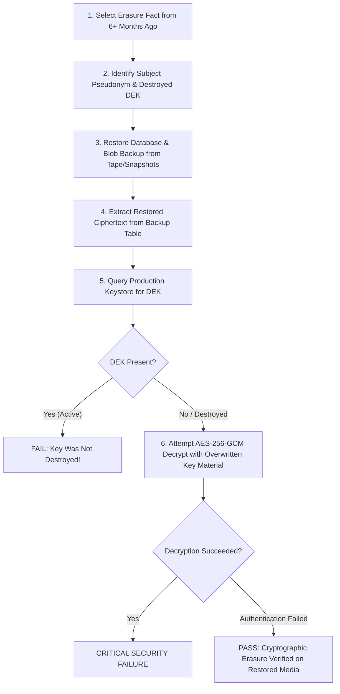

# Athar Operational Runbook & Systems Guide

**Status:** Operational Guidance  
**System:** Athar Verifiable Erasure Core  
**Author:** Khafi Labs (My Personal Laboratories)  

---

## 1. Key Lifecycle Management & Rotation

Athar implements a three-tier key hierarchy designed for minimal operational complexity and granular cryptographic erasure.

```
+-------------------------------------------------------+
| Tier 1: KEK (Key Encryption Key)                       |
| Root of trust. Stored in KMS/HSM. Rotated annually.   |
+-------------------------------------------------------+
                           │ wraps
                           ▼
+-------------------------------------------------------+
| Tier 2: PPK (Purpose-Period Key)                       |
| Scoped by purpose & time period. Rotated monthly.      |
+-------------------------------------------------------+
                           │ wraps
                           ▼
+-------------------------------------------------------+
| Tier 3: DEK (Data Encryption Key)                      |
| Ephemeral AES-256-GCM key per subject and purpose.    |
+-------------------------------------------------------+
```

### 1.1 KEK (Key Encryption Key) Rotation
- **Frequency:** Annually or upon credential compromise alert.
- **Procedure:**
  1. Generate new KEK in KMS/HSM (`new_kek_id = keystore.generate_kek()`).
  2. For all active PPKs, re-wrap the PPK material using `new_kek_id`:
     $$\text{wrapped\_ppk}' = \text{AES-GCM}(\text{new\_kek}, \text{unwrapped\_ppk})$$
  3. Update `parent_key_id` in the keystore record to point to `new_kek_id`.
  4. Deprecate the old KEK into `RETIRED` state (read-only for historic unwrap if needed; never deleted until all child PPKs expire).

### 1.2 PPK (Purpose-Period Key) Rotation
- **Frequency:** Monthly (e.g. `period = "2026-10"`, `"2026-11"`).
- **Procedure:**
  1. On the 1st of each calendar month, the keystore automator invokes `generate_ppk()` under the active KEK for each supported business purpose.
  2. New records ingested during the month are encrypted with DEKs wrapped under the new month's PPK.
  3. Historic PPKs remain `ACTIVE` until their statutory purpose retention window completely elapses.
  4. When an entire month's purpose retention expires across all subjects, the entire PPK can be cascade-destroyed (`destroy_cascade(ppk_id)`), instantly crypto-erasing thousands of child DEKs in a single operation.

### 1.3 DEK (Data Encryption Key) Destruction
- **Trigger:** Erasure saga reaching `KEY_DESTROYED` state.
- **Procedure:**
  1. In-place memory overwrite with zeros.
  2. Keystore metadata marked `DESTROYED`, and `destroyed_at` timestamp set.
  3. If no other active DEKs exist for the subject, the subject's PPK reference is unlinked.

---

## 2. Signing-Key Retention for Long-Lived Receipts

Receipts must remain independently verifiable for years or decades (e.g., 7–10 years for statutory audit defense).

### 2.1 Public Key Longevity & Distribution
- **Never Destroy Public Verification Keys:** An Ed25519 public key (32 bytes) contains zero sensitive personal data. It MUST be preserved permanently in public key directories, DNS TXT records, and certificate transparency ledgers.
- **Public Key Archival:**
  - Store public keys in a versioned, immutable Git repository or S3 bucket with Object Lock enabled.
  - Publish public keys via an HTTPS JWKS endpoint (`/.well-known/athar-keys.json`).
  - Distribute public key fingerprints to accredited third-party auditing partners.

### 2.2 Signing Key Rotation
- **Private Key Rotation:** Rotate the Ed25519 receipt signing private key every 2 years.
- When an old signing key is retired:
  - Keep its corresponding public key permanently available for verifying historical receipts.
  - Receipts signed with the retired key remain mathematically valid because verification only requires the public key.

---

## 3. Disaster Recovery Decryption Drill ("Restore Drill")

To maintain legal defensibility, organizations MUST conduct quarterly disaster recovery restore drills to prove that crypto-erased records cannot be decrypted from backup media.



### Drill Execution Steps
1. **Sample Selection:** Select 5 random erasure receipts issued more than 90 days ago.
2. **Cold Media Restoration:** Spin up an isolated staging sandbox and restore cold backup tapes / snapshots created *before* the erasure date.
3. **Ciphertext Extraction:** Verify that the encrypted ciphertext records still exist on the restored backup database.
4. **Decryption Probe:** Attempt to decrypt the restored ciphertext using the current keystore:
   - Keystore MUST raise `KeyDestroyedError` (`[SIMULATED] Key <id> has been destroyed`).
   - If attempting brute-force decryption with zeroed key material, AES-256-GCM MUST fail with authentication tag mismatch.
5. **Attestation Log:** Record the drill outcome with auditor timestamps.

---

## 4. Backup & Log Procedures

### 4.1 Append-Only Fact Log Backup
- The Merkle Tree fact log and its SQLite persistence database (`SagaPersistence`) contain audit facts, NOT personal data.
- **Backup Rule:** Replicate the fact log and batch records continuously to redundant geographic zones.
- **Tamper Evidence:** Because every batch is chained into a Merkle root anchored externally, any silent corruption in backup storage is immediately detected when computing consistency proofs.

### 4.2 Storage Surface Purge Auditing
- Maintain operational logs of connector purge runs:
  - Rows affected
  - Files removed
  - Canaries scanned
- Retain connector logs for 12 months for operational troubleshooting.

---

## 5. Incident Response & Hold Interception

If a regulatory subpoena or court litigation notice arrives for a subject:
1. Immediately issue a `LegalHold`:
   ```python
   policy_engine.add_hold(
       LegalHold(
           hold_id="HOLD-2026-US-COURT-004",
           scope="subj_alice_9821",
           reason="Subpoena from SEC Case 26-cv-0912",
           issuer="Chief Legal Officer",
           started_at=datetime.now(timezone.utc),
       )
   )
   ```
2. Any erasure saga in `PLANNED`, `INTENT_LOGGED`, or `KEY_SCHEDULED` state will halt immediately upon hold revalidation and transition to `FAILED_PARTIAL`.
3. The subject's DEK is protected from destruction as long as the hold remains active.
