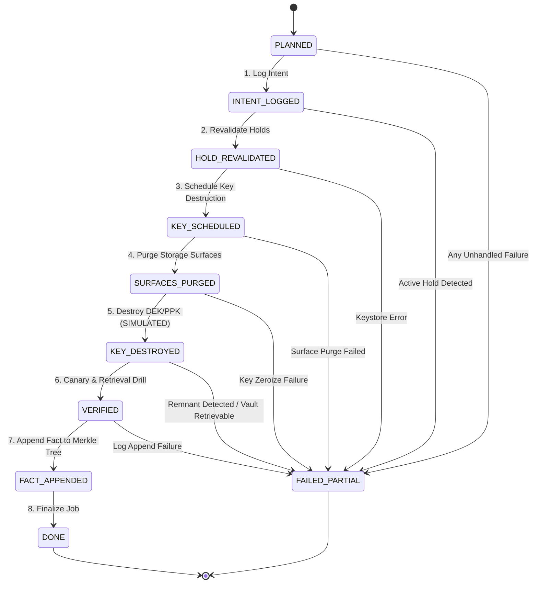

# Erasure Saga State Machine Specification

**Status:** Normative Specification  
**System:** Athar Verifiable Erasure Core  
**Author:** Khafi Labs (My Personal Laboratories)  

---

## 1. Overview

The **Erasure Saga** coordinates the irreversible, verifiable erasure of personal data across heterogeneous storage surfaces, cryptographic key management tiers, active legal holds, and an append-only audit log.

Because distributed deletions risk partial failure (e.g., database purged but search index offline, or key destroyed before secondary replicas are wiped), Athar executes erasures as a **durable, resumable, forward-only saga** backed by transactional persistence.

---

## 2. Saga Lifecycle States

The saga defines ten distinct states represented by the `SagaState` enum:



### 2.1 State Definitions

| State | Ordinal | Invariant / Description |
|---|---|---|
| `PLANNED` | 0 | The erasure job is formulated. Eligibility evaluation under the active policy has succeeded (`ELIGIBLE`). An `ErasureManifest` is prepared enumerating target storage surfaces and declared gaps. |
| `INTENT_LOGGED` | 1 | An `erasure_intent` event has been committed to the append-only log or fact buffer. This establishes a public or auditable declaration of intent before destructive actions occur. |
| `HOLD_REVALIDATED` | 2 | Legal holds are re-evaluated immediately prior to key destruction scheduling. If any active hold targeting this subject pseudonym or `ALL` scope was registered after planning, execution halts immediately. |
| `KEY_SCHEDULED` | 3 | Key destruction has been registered with the keystore with a defined grace period offset (`scheduled_destruction = now + grace_period`). Prevents immediate unannounced key loss. |
| `SURFACES_PURGED` | 4 | All storage connectors (relational databases, filestores, document stores, caches, search indexes, log aggregators) have executed their targeted purge for the subject and purpose. |
| `KEY_DESTROYED` | 5 | The subject's Data Encryption Key (DEK) is destroyed. If this was the last purpose for the subject, the Pseudonym Protection Key (PPK) is also destroyed. In Athar MVP, this destruction is labeled **SIMULATED**. |
| `VERIFIED` | 6 | An automated canary and retrieval test is executed: the vault attempts decryption (expecting decryption failure), and connectors run remnant scans (expecting zero hits). |
| `FACT_APPENDED` | 7 | The final `erasure_completed` fact is appended to the RFC 6962 Merkle log. The leaf index and fact ID are committed. |
| `DONE` | 8 | Terminal success state. The job is closed. Merkle batches can now be anchored and receipts constructed. |
| `FAILED_PARTIAL` | 9 | Terminal failure state. An unrecoverable error occurred at one of the stages. The job cannot advance automatically; manual remediation or operator intervention is required. |

---

## 3. State Transition Rules

1. **Strict Forward Progression:** A job in state $S_i$ MAY only advance to state $S_{i+1}$ upon the successful completion of the step. Skipping states is strictly forbidden.
2. **Atomic State Updates:** Every state transition MUST be committed to durable persistence (`SagaPersistence`) before initiating the subsequent operational step.
3. **Audit History Accumulation:** Every transition appends a `(state, timestamp)` tuple to `ErasureJob.state_history`. This history MUST be preserved across system crashes, restarts, and retries.
4. **Transition to Failure:** If an exception occurs during the execution of any step, the job MUST transition to `FAILED_PARTIAL`. The error message MUST be stored in `ErasureJob.error` and persisted before halting.

---

## 4. Idempotency Requirements

Because distributed systems experience timeouts, network partitions, and host reboots, all saga operations MUST be idempotent:

### 4.1 Connector Purges (`SURFACES_PURGED`)
- Purge invocations for a subject and purpose MUST be safe to execute multiple times.
- If a connector is invoked for records that were already deleted in a prior aborted run, the connector MUST return `status = "purged"` with `rows_affected = 0` (or `files_affected = 0`), NOT raise an error.
- Re-running an already purged connector MUST NOT alter other subjects' data or cause data corruption.

### 4.2 Key Destruction (`KEY_DESTROYED`)
- Invoking `destroy_dek()` or `destroy_ppk()` on a key that is already destroyed MUST succeed silently or return confirmation of destruction.
- Attempting to destroy a destroyed key MUST NOT resurrect or overwrite unaffected keys.

### 4.3 Log Append (`INTENT_LOGGED` & `FACT_APPENDED`)
- When resuming from a crash, the saga checks if an intent or completion fact with the same `job_id` has already been appended.
- If already appended, the existing fact reference is retained to avoid duplicate leaves in the Merkle log.

---

## 5. Crash Recovery and Resumption

### 5.1 Recovery Invariants
When a worker crashes or restarts:
1. The process queries `SagaPersistence.list_incomplete()` for any jobs where:
   $$\text{state} \notin \{\text{DONE}, \text{FAILED\_PARTIAL}\}$$
2. The orchestrator calls `saga.resume(job_id)`.
3. The saga reads the last persisted state and executes from that exact boundary:
   - If persisted at `PLANNED`: Restart from logging intent.
   - If persisted at `INTENT_LOGGED`: Perform hold revalidation.
   - If persisted at `HOLD_REVALIDATED`: Proceed to schedule key destruction.
   - If persisted at `KEY_SCHEDULED`: Proceed to purge surfaces.
   - If persisted at `SURFACES_PURGED`: Proceed to destroy keys.
   - If persisted at `KEY_DESTROYED`: Proceed to canary verification.
   - If persisted at `VERIFIED`: Proceed to append fact to Merkle log.
   - If persisted at `FACT_APPENDED`: Mark as `DONE`.

### 5.2 Mid-Step Crash Handling
If a crash occurs *during* the execution of a step (before the next state is persisted):
- The persisted state remains at $S_i$.
- Upon resume, the step for $S_i \to S_{i+1}$ is re-executed from the beginning.
- By virtue of the **idempotency requirements** (Section 4), re-running the partial operation is safe and deterministic.

---

## 6. Error Handling and Compensation

### 6.1 `FAILED_PARTIAL` Semantics
When a job enters `FAILED_PARTIAL`:
- `job.error` records the diagnostic cause (e.g., `"Surfaces purge failure: ElasticSearch connection timed out"` or `"Remnants detected: DatabaseConnector (2 items: ['rec-04', 'rec-09'])"`).
- The state history retains the full sequence of states prior to failure.
- **Safety Rule:** If surfaces were purged but verification failed, keys MUST NOT be scheduled for un-erasure. In cryptographic systems, once a DEK is destroyed, ciphertext recovery is impossible.
- Remediation:
  - If a connector temporarily failed, an administrator can fix network connectivity and invoke a repair runner that re-verifies surfaces and drives the job to completion.
  - If a legal hold blocked execution during `HOLD_REVALIDATED`, the job remains in `FAILED_PARTIAL` until the legal hold is formally lifted by an authorized officer.

---

## 7. Storage Persistence Schema

In the reference implementation, jobs are stored in SQLite using the following schema:

```sql
CREATE TABLE IF NOT EXISTS erasure_jobs (
    job_id TEXT PRIMARY KEY,
    state TEXT NOT NULL,
    subject_pseudonym TEXT NOT NULL,
    purpose TEXT NOT NULL,
    policy_hash TEXT NOT NULL,
    manifest_json TEXT NOT NULL,
    eligibility_decision_json TEXT NOT NULL,
    state_history_json TEXT NOT NULL,
    error TEXT,
    created_at TEXT NOT NULL,
    updated_at TEXT NOT NULL
);

CREATE INDEX IF NOT EXISTS idx_jobs_state ON erasure_jobs(state);
CREATE INDEX IF NOT EXISTS idx_jobs_subject ON erasure_jobs(subject_pseudonym);
```

All JSON columns (`manifest_json`, `eligibility_decision_json`) are encoded in RFC 8785 Canonical JSON to guarantee audit reproducibility.
